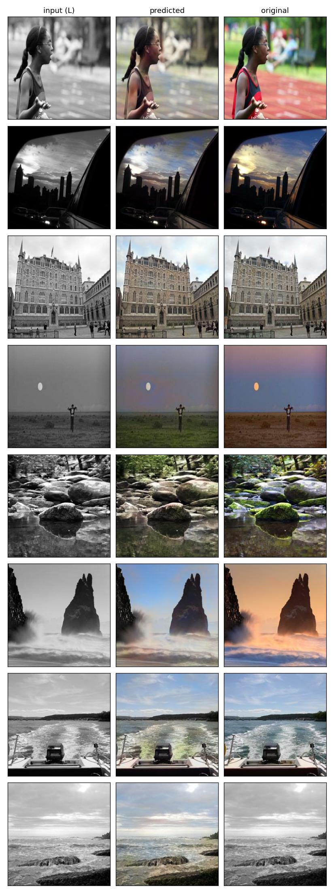
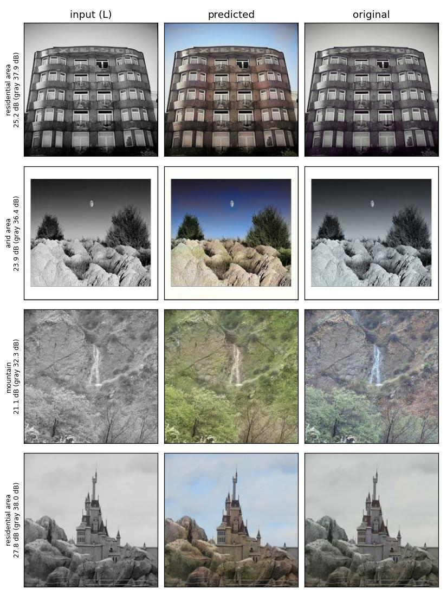
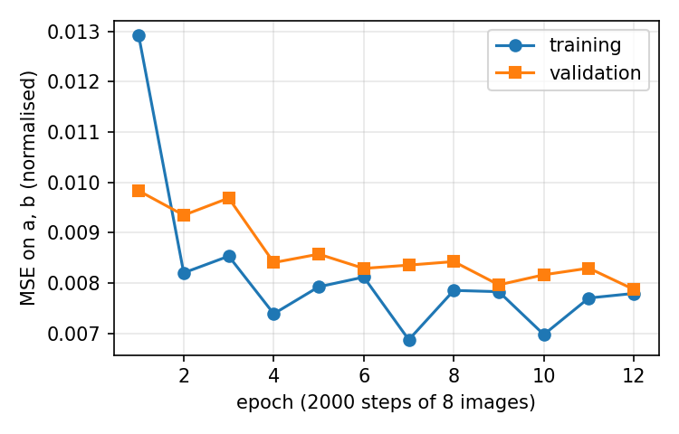

# Image colorization with a U-Net decoder on a pretrained VGG16 encoder

Predicts the colours of a grayscale photo. Each image is converted to the CIELAB colour space; the network
sees only the lightness channel *L* and predicts the two colour channels *a* and *b*, which are then
recombined with *L* to give an RGB image.



*Eight test images drawn at random (fixed seed, not hand-picked). Columns: the L input, the prediction, the
original photo.*

## Results

Trained on 45,000 Places365 scene images and evaluated on 2,500 held-out test images that were not used for
training or model selection. The baseline is the grayscale image itself (the true *L* with *a* = *b* = 0).

| | Model | Grayscale baseline |
|---|---|---|
| Error on *a, b* (MSE, normalised units) | **0.0079** | 0.0131 |
| Error on *a, b* (MAE, normalised units) | **0.060** | 0.075 |
| PSNR, median over images (dB) | **25.3** | 22.9 |
| PSNR, mean over the 2,431 colour photos (dB) | **25.0** | 23.2 |
| Images where the model has the higher PSNR | 74% | |
| SSIM, mean | **0.949** | 0.945 |
| Colourfulness (Hasler and Süsstrunk, 2003) | 24.8 | 38.1 (originals) |

- The colour error is **40% lower** than the baseline's (MSE; 20% lower in MAE).
- 69 of the 2,500 test photos are black and white to begin with. The baseline reproduces those almost exactly
  (PSNR around 100 dB), which pulls its mean PSNR over all 2,500 images up to 25.3 dB, against 25.1 dB for the
  model. Without them the model leads by 1.8 dB on average and has the higher PSNR on 76% of the images.
- SSIM barely moves, because it is dominated by the *L* channel, which both share.
- Predicted colours are muted: about 65% as colourful as the originals. With a mean-squared-error loss, a pixel
  whose colour is ambiguous (a car, a sky at sunset) is pulled towards the average of its plausible colours,
  which is close to gray.

### By scene category

| Category | Test images | *a, b* MSE, model | *a, b* MSE, gray | Change | Median PSNR, model / gray (dB) | Model has higher PSNR |
|---|---|---|---|---|---|---|
| athletic field | 250 | 0.0108 | 0.0218 | -50% | 23.2 / 20.4 | 88% |
| park | 226 | 0.0086 | 0.0173 | -50% | 24.8 / 21.7 | 87% |
| forest | 258 | 0.0086 | 0.0167 | -49% | 25.4 / 23.0 | 72% |
| residential area | 234 | 0.0048 | 0.0080 | -40% | 27.0 / 25.1 | 72% |
| inland water body | 268 | 0.0064 | 0.0107 | -40% | 25.7 / 23.8 | 73% |
| arid area | 290 | 0.0093 | 0.0152 | -39% | 24.5 / 21.5 | 79% |
| mountain | 250 | 0.0082 | 0.0124 | -34% | 25.2 / 23.4 | 70% |
| industrial area | 236 | 0.0058 | 0.0085 | -31% | 26.9 / 25.0 | 72% |
| downtown | 254 | 0.0065 | 0.0089 | -26% | 26.4 / 25.1 | 68% |
| ocean | 234 | 0.0098 | 0.0115 | -15% | 24.4 / 22.7 | 62% |

The model does best where colour follows from texture and brightness (grass, foliage, sky over buildings) and
worst on ocean scenes, where the same gray level can be blue water, a gray overcast sea or an orange sunset.

### Failure cases



The four colour photos with the largest PSNR loss against the baseline. All four are nearly monochrome or toned
photos, which the model colours like ordinary scenes (blue sky, green vegetation).

### Training



Each epoch is 2,000 steps of 8 images (16,000 images), so the 12 epochs cover the 45,000 training images about
4.3 times. Training took 4.3 hours on a 4 GB laptop GPU (NVIDIA RTX 2050) with mixed precision. The learning
rate started at 1e-4 and was halved whenever the validation loss did not improve, down to 1.6e-6. The run
stopped at its time budget; the best validation loss (0.00787) came in the last epoch, so longer training may
still help slightly.

## Why the decoder has batch normalisation

`Automatic_Colourizer.ipynb` is the first version of this project, written for Google Colab. Its saved training
run stalled. After 2,843 steps the training loss was 0.87 and the MAE 0.93, while predicting no colour at all
gives about 0.014. An MAE that close to 1 means the tanh output was pinned at ±1, where its gradient is almost
zero.

To find the cause, `compare_variants.py` trains four versions for 1,500 steps each, with the same seed and data
order, and scores them on 800 validation images:

| VGG16 input | Batch norm in decoder | Validation MSE on *a, b* | Against predicting no colour |
|---|---|---|---|
| *L* in [0, 1], as in the notebook | no | 0.00980 | -30% |
| *L* in [0, 1] (final model) | yes | 0.00979 | -30% |
| ImageNet range (0-255, mean removed) | no | 0.971, does not train | |
| ImageNet range (0-255, mean removed) | yes | 0.01093 | -22% |

With VGG16's own ImageNet input range, 98% of the outputs start saturated, and without batch normalisation all
of them stay at ±1. With the notebook's [0, 1] input, the share of saturated outputs at initialisation varied
between runs here (from 1% to 42%) and this decoder trained normally, so the notebook's stall depends on the
random start. Batch normalisation after each decoder convolution removed the problem in every run and does not
change the final error, so the final model uses it. The numbers are in `results/variant_comparison.json`.

## Model

- **Input:** the *L* channel at 256×256, scaled to [0, 1] and repeated to three channels for VGG16.
- **Encoder:** VGG16 pretrained on ImageNet, frozen (14.7 M parameters).
- **Skip connections** from `block1_conv2`, `block2_conv2`, `block3_conv3` and `block4_conv3`; the bottleneck is
  `block5_conv3` (16×16).
- **Decoder:** four stages of 2× upsampling, concatenation with the matching encoder features and two 3×3
  convolutions, each followed by batch normalisation and ReLU (512, 256, 128 and 64 channels); 10.2 M
  trainable parameters.
- **Output:** a 1×1 convolution with tanh gives *a* and *b* in [-1, 1] (*a* / 128 and *b* / 128).
- **Loss:** mean squared error on *a, b*; Adam, learning rate 1e-4, batch size 8.

## Data

50,000 scene images (256×256) from a Places365 subset on Kaggle
([`bobaaayoung/place365`](https://www.kaggle.com/datasets/bobaaayoung/place365)), in ten categories: five
man-made (athletic field, downtown, industrial area, park, residential area) and five natural (arid area,
forest, inland water body, mountain, ocean). The images are split once with a fixed seed into 45,000 for
training, 2,500 for validation (learning-rate schedule and choice of the best epoch) and 2,500 for testing.
The conversion from RGB to CIELAB is written in TensorFlow (same constants as OpenCV) so that it runs inside
the `tf.data` pipeline.

## Running

Python 3.10 with the versions in `requirements.txt` (TensorFlow 2.10, the last release with GPU support on
native Windows).

```
pip install -r requirements.txt
kaggle datasets download bobaaayoung/place365 -p data/place365 --unzip
```

The download needs the Kaggle command-line tool and an API token; alternatively, download the zip from the
dataset page and unzip it into `data/place365` (giving `data/place365/DATA-1/artificial/...` and `.../natural/...`).

Colorize your own photos with the trained weights (any size; the colour is predicted at 256×256 and combined
with the photo's full-resolution *L* channel):

```
python colorize.py photo.jpg                  # writes photo_colorized.jpg
```

Train, evaluate and compare the variants:

```
python train.py --data data/place365/DATA-1 --out runs/main --steps_per_epoch 2000 --hours 4.25 --gpu_memory_mb 3000
python evaluate.py --data data/place365/DATA-1 --run runs/main --out results
python compare_variants.py --data data/place365/DATA-1 --steps 1500 --out results/variant_comparison.json
```

`--gpu_memory_mb 3000` lets TensorFlow use 3 GB of a 4 GB card; by default on Windows it reserves less, which
is not enough for batch size 8. A run that is interrupted resumes from its last finished epoch when started
again with the same `--out`.

## Files

| File | Contents |
|---|---|
| `colorizer.py` | data pipeline (RGB to CIELAB), dataset split, model, saving and loading the decoder |
| `train.py` | training with checkpoints, learning-rate schedule, early stopping and a time budget |
| `evaluate.py` | test metrics, per-category results and the figures |
| `compare_variants.py` | short runs comparing input scaling and batch normalisation |
| `colorize.py` | colorizes image files with the trained weights |
| `weights/decoder_weights.npz` | trained decoder weights (37 MB); the encoder is the standard Keras VGG16 |
| `results/` | `metrics.json`, `test_per_image.csv`, `variant_comparison.json`, `train_log.csv` and the figures |
| `Automatic_Colourizer.ipynb` | the original Colab notebook |

## Limitations

- The colours are muted, as expected from a regression loss. Treating colour prediction as classification over
  quantised *a, b* bins with class rebalancing (Zhang, Isola and Efros, *Colorful Image Colorization*, ECCV
  2016) gives more saturated results.
- Ten scene categories only, at 256×256; people and close-up objects are rare in the training data.
- Scenes whose colour is not implied by their content (sunsets, water, toned or faded photos) get the most
  common colour for that kind of scene.
